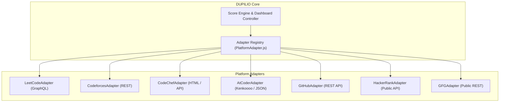

# DUPILIO — Platform Integrations & Adapter Architecture

> **Brand Statement**: *One profile. Every opportunity. A smarter path to your next role.*

---

## 1. Adapter Architecture Overview

DUPILIO isolates all platform-specific communication behind normalized **Platform Adapters** (`backend/src/services/platforms/`). External schemas never leak into React components or core business logic.



---

## 2. Common Normalized Schema

Every adapter implements the `PlatformAdapter` interface and normalizes incoming data into the standard DUPILIO structure:

```typescript
interface NormalizedProfile {
  platform: 'leetcode' | 'codeforces' | 'codechef' | 'atcoder' | 'github' | 'hackerrank' | 'gfg';
  username: string;
  rating: number;
  rank: string;
  solved: number;
  contests: number;
  badges: number;
  streak: number;
  difficultyBreakdown: {
    easy: number;
    medium: number;
    hard: number;
  };
  recentActivity: Array<{
    title: string;
    timestamp: number;
    url?: string;
  }>;
  rawStats: Record<string, any>;
  lastSyncedAt: string;
}
```

---

## 3. Platform Implementations & Endpoints

### 1. LeetCode (`LeetCodeAdapter.js`)
- **Transport**: HTTPS POST to `https://leetcode.com/graphql`.
- **Headers**: Desktop `User-Agent` and `Referer: https://leetcode.com`.
- **Query**: Queries `matchedUser(username)`, `submitStatsGlobal.acSubmissionNum`, and `userContestRanking`.
- **Zero Dummy Data**: Explicitly throws error if `errors[0].message` states `"That user does not exist."`.

### 2. Codeforces (`CodeforcesAdapter.js`)
- **Transport**: HTTPS GET to `https://codeforces.com/api/`.
- **Endpoints**: `user.info?handles=`, `user.rating?handle=`, `user.status?handle=`.
- **Solved Count**: Filters `user.status` for unique problem identifiers where `verdict === 'OK'`.
- **Live Contests**: Ingests upcoming rounds from `https://codeforces.com/api/contest.list?gym=false`.

### 3. CodeChef (`CodeChefAdapter.js`)
- **Transport**: HTTPS GET to `https://www.codechef.com/users/{handle}` and `https://www.codechef.com/api/list/contests/all`.
- **Extraction**: Scrapes rating numbers (`.rating-number`), stars rating, and problem counts.

### 4. AtCoder (`AtCoderAdapter.js`)
- **Transport**: Kenkoooo API (`https://kenkoooo.com/atcoder/atcoder-api/v2/user_info?user=`) and official history endpoint (`https://atcoder.jp/users/{handle}/history/json`).
- **Contests**: Scrapes live upcoming AtCoder contests from `https://atcoder.jp/contests/`.

### 5. GitHub (`GitHubAdapter.js`)
- **Transport**: GitHub REST API v3 (`https://api.github.com/users/{username}`).
- **Metrics Extracted**: Public repository counts, total stargazer counts, follower counts, primary languages, and repository topics for tech stack detection.

### 6. HackerRank (`HackerRankAdapter.js`) & GeeksforGeeks (`GFGAdapter.js`)
- Queries public profiles and badge rankings without requiring credentials.

---

## 4. Voice Reminder Abstraction (Section 31)

Contest alerts support automated voice reminders via a pluggable provider interface (`VoiceProvider.js`):

```javascript
export class VoiceProvider {
  async createCall(to, message) { throw new Error('Not implemented'); }
  async scheduleCall(to, message, triggerTime) { throw new Error('Not implemented'); }
  async cancelCall(callId) { throw new Error('Not implemented'); }
}
```

- **Default Implementation**: `MockVoiceProvider.js` logs automated call triggers with speech synthesis transcripts and simulated carrier routing.
- **Production Drop-in**: Replace with Twilio / Exotel / AWS Polly by injecting provider credentials into `.env`.
